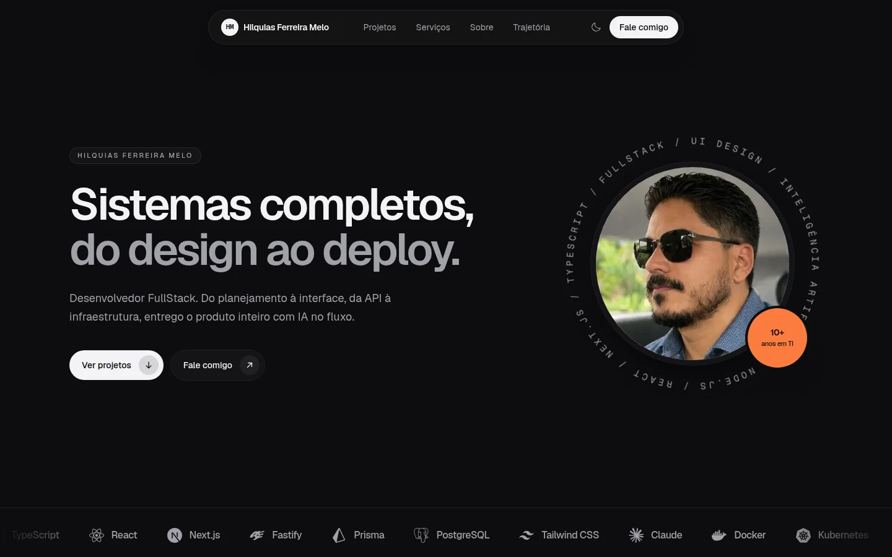

<div align="center">

# hfmelo.dev

Portfolio pessoal de **Hilquias Ferreira Melo**, desenvolvedor FullStack em São Luís, Maranhão.

[](https://nextjs.org)
[](https://react.dev)
[](https://www.typescriptlang.org)
[](https://tailwindcss.com)
[](https://biomejs.dev)



</div>

## Sobre

Site de apresentação com os sistemas que desenhei e desenvolvi de ponta a ponta, da interface à API e à infraestrutura. Reúne projetos em produção para a OAB Maranhão e a CAAMA, produtos próprios, trajetória profissional, formação e contato.

O site é uma página única, prerenderizada de forma estática. O único trecho de servidor é a validação do Cloudflare Turnstile no portão de entrada. Todo o conteúdo fica em arquivos de dados tipados, o que torna simples incluir um projeto novo ou ajustar um texto sem mexer nos componentes.

## Destaques técnicos

- **Next.js 16 com App Router**, Cache Components e React Compiler. Todas as rotas, inclusive a imagem Open Graph e o ícone, são geradas no build.
- **Tema escuro por padrão**, com alternância manual que fica salva no navegador (`next-themes`).
- **Screenshots que acompanham o tema**: quando existe a mesma tela nos modos claro e escuro, a imagem troca junto com o site, e só a versão visível é carregada.
- **Animações com Motion** (entrada por scroll, menu mobile e microinterações), desligadas automaticamente para quem usa `prefers-reduced-motion`.
- **Design system próprio em Tailwind CSS 4**: tokens de cor em OKLCH, um único acento, raios e sombras padronizados.
- **Acessibilidade**: navegação por teclado, textos alternativos, contraste AA e marcação semântica (`nav`, `ol`, `dl`).
- **SEO e compartilhamento**: metadados completos, `lang="pt-BR"` e imagem Open Graph gerada com `next/og`.
- **Cuidado com dados nos prints**: dados pessoais de terceiros e credenciais foram recortados ou pixelados antes de entrar no repositório.

## Stack

| Camada | Tecnologias |
| --- | --- |
| Framework | Next.js 16, React 19, React Compiler |
| Linguagem | TypeScript 5 |
| Estilo | Tailwind CSS 4, `clsx`, `tailwind-merge` |
| Animação | Motion |
| Ícones | Phosphor Icons, Simple Icons |
| Tema | next-themes |
| Segurança | Cloudflare Turnstile, Zod (validação das variáveis de ambiente) |
| Qualidade | Biome (lint, formatação e ordenação de classes) |
| Gerenciador | pnpm |

## Como rodar

Pré-requisitos: Node.js 20.9 ou superior e pnpm.

```bash
pnpm install          # instala as dependências
cp .env.example .env  # chaves de teste do Turnstile (sempre aprovam)
pnpm dev              # http://localhost:3000
```

As variáveis de ambiente são validadas com Zod em `src/env/` ao carregar o `next.config.ts`: se faltar alguma, o `dev` e o `build` param com a mensagem do que está faltando.

| Variável | Onde é usada |
| --- | --- |
| `NEXT_PUBLIC_TURNSTILE_SITE_KEY` | Widget do Turnstile no navegador |
| `TURNSTILE_SECRET_KEY` | Validação do token no servidor (Server Action) |

| Script | O que faz |
| --- | --- |
| `pnpm dev` | Ambiente de desenvolvimento |
| `pnpm build` | Build de produção |
| `pnpm start` | Servidor de produção a partir do build |
| `pnpm lint` | Verificação com Biome |
| `pnpm format` | Formatação com Biome |

## Portão "prove que você não é um robô"

Na primeira visita, antes do site, aparece um "teste de Turing reverso": um diagnóstico em tom de piada que usa sinais do próprio navegador (horário, tema do sistema, mouse ou toque, `navigator.webdriver`) enquanto o Cloudflare Turnstile valida de verdade em segundo plano. Depois da aprovação, a confirmação fica no `localStorage` (`hfmelo:human-verified`) e o portão não aparece mais naquele navegador.

- **Ninguém fica de fora**: se o Turnstile falhar, demorar mais de 10 s ou travar no desafio, a entrada é liberada com outra piada.
- **SEO intacto**: o conteúdo continua no HTML. Crawlers, geradores de prévia (WhatsApp, LinkedIn) e quem está sem JavaScript não veem o portão.
- **Sem flash**: um script inline marca o `<html>` antes do primeiro paint, e o CSS só mostra o portão com essa marca.
- Para ver de novo, apague a chave `hfmelo:human-verified` no DevTools (Application → Local Storage) ou abra uma janela anônima.

No painel do Turnstile, o widget precisa listar os domínios do site e `localhost`. Para quem é IA, existe ainda o `public/llms.txt`.

## Estrutura

```
src/
  app/            layout, página, estilos globais, ícone e imagem Open Graph
  components/
    human-gate/   portão de verificação (Turnstile, diagnóstico e script anti-flash)
    sections/     seções da página (hero, projetos, serviços, sobre, trajetória, contato)
    ui/           componentes reutilizáveis (botões, títulos de seção)
  data/           conteúdo do site: perfil, experiências, formação e projetos
  env/            variáveis de ambiente validadas com Zod (cliente e servidor)
  lib/            utilitários e a Server Action que valida o Turnstile
  assets/         arquivos usados na geração da imagem Open Graph
public/
  projects/       screenshots dos projetos (WebP)
docs/             imagens do README
```

## Editando o conteúdo

Não é preciso mexer nos componentes para atualizar o site:

- **`src/data/profile.ts`**: nome, cargo, contatos, números da seção "Sobre", experiências, formação e certificações.
- **`src/data/projects.ts`**: projetos em destaque (com screenshot, stack e link) e a lista de projetos menores.

Para incluir um projeto em destaque, adicione o screenshot em `public/projects/` e uma nova entrada em `featuredProjects`. O campo `url` é opcional: sem ele, o card aparece sem o botão "Visitar". Para screenshots com versão clara e escura da mesma tela, informe `srcLight`.

## Contato

- E-mail: [contato@hfmelo.dev](mailto:contato@hfmelo.dev)
- LinkedIn: [linkedin.com/in/hfmelodev](https://www.linkedin.com/in/hfmelodev)
- Instagram: [@hilquiasfmelo](https://www.instagram.com/hilquiasfmelo/)
- GitHub: [@hfmelodev](https://github.com/hfmelodev)

## Licença

O código está disponível para consulta e estudo. Textos, fotos e screenshots dos projetos pertencem a Hilquias Ferreira Melo e às respectivas instituições, e não devem ser reutilizados sem autorização.
